<div align="center">

<a href="https://github.com/NickiCat/yakey-desktop/releases/latest"></a>

**English** · [Русский](README.ru.md)

</div>

**yakey** generates your Yandex Key one-time codes on the computer. It imports accounts from the Yandex Key cloud backup once, keeps them in an encrypted vault and shows TOTP and Yandex OTP codes. It is free and open source, with no telemetry.

> Unofficial project, not affiliated with or endorsed by Yandex.

## Download

<a href="https://github.com/NickiCat/yakey-desktop/releases/download/v0.4.0/yakey-0.4.0-1-x86_64.pkg.tar.zst"></a>
<a href="https://github.com/NickiCat/yakey-desktop/releases/download/v0.4.0/yakey_0.4.0_amd64.deb"></a>
<a href="https://github.com/NickiCat/yakey-desktop/releases/download/v0.4.0/yakey-0.4.0.x86_64.rpm"></a>
<a href="https://github.com/NickiCat/yakey-desktop/releases/download/v0.4.0/yakey-0.4.0-setup.exe"></a>

Version 0.4.0, x86-64 · [all releases](https://github.com/NickiCat/yakey-desktop/releases) · [SHA-256 checksums](https://github.com/NickiCat/yakey-desktop/releases/download/v0.4.0/SHA256SUMS)

<details>
<summary><b>Install</b></summary>
<br>

```sh
# Arch
sudo pacman -U ./yakey-0.4.0-1-x86_64.pkg.tar.zst

# Debian, Ubuntu
sudo apt install ./yakey_0.4.0_amd64.deb

# Fedora
sudo dnf install ./yakey-0.4.0.x86_64.rpm
```

On Windows, run `yakey-0.4.0-setup.exe`. The installer isn't code-signed, so SmartScreen shows a warning: **More info** → **Run anyway**.

</details>

## What it does

Open any row.

<details>
<summary><b>Imports the cloud backup</b></summary>
<br>

Phone number, SMS code, backup password, and your accounts are in. Repeated imports skip the secrets you already have. The protocol follows [YandexKeyExtractor](https://github.com/ezhevita/YandexKeyExtractor).

</details>

<details>
<summary><b>Generates codes</b></summary>
<br>

TOTP with SHA1, SHA256 or SHA512 and 6 to 8 digits, plus Yandex OTP: 8 letters, with a PIN. The backup doesn't store the PIN, so you enter it during import or later on the account's card.

</details>

<details>
<summary><b>Adds accounts by hand</b></summary>
<br>

An `otpauth://` link, a base32 secret, or a QR code from an image file. On Linux with wlroots, also from a screen area, using `grim` and `slurp`.

</details>

<details>
<summary><b>Protects the vault</b></summary>
<br>

Argon2id and XChaCha20-Poly1305, with atomic writes. The vault locks with the screen, on sleep and after 5 idle minutes by default. The master password can be strict, simple, a short PIN, or turned off, in which case the system keyring holds the vault key.

</details>

<details>
<summary><b>Clears the clipboard</b></summary>
<br>

A copied code leaves the clipboard after 30 seconds if it's still there. On Wayland it's copied with `wl-copy --sensitive`, so clipboard history managers such as cliphist skip it.

</details>

<details>
<summary><b>Stays in the tray</b></summary>
<br>

A tray icon, gray when locked, opens the app, starts the quick picker, copies any account's code and locks the vault.

</details>

<details>
<summary><b>Works from a hotkey (Linux)</b></summary>
<br>

```sh
yakey --hidden         # start in the background
yakey --pick           # search window, Enter copies the code
yakey --pick --paste   # the same, but types the code with wtype
yakey --lock           # lock the vault
yakey --lock --full    # lock and wipe the key from memory
yakey --copy github    # copy a code by name
```

Hyprland examples are in [contrib](contrib). Optional packages: `wl-clipboard`, `wtype`, `grim`, `slurp`, `fprintd`.

</details>

<details>
<summary><b>Unlocks with a fingerprint (Linux)</b></summary>
<br>

With `fprintd`, after you've entered the password once, a finger unlocks the vault for up to 8 hours by default. After a restart, once that time runs out or after `yakey --lock --full`, it asks for the password again.

</details>

## Linux or Windows

| | Linux | Windows |
|---|---|---|
| Import, codes, tray, picker window | Yes | Yes |
| Lock with the screen and on sleep | Yes | Yes |
| Passwordless mode | gnome-keyring or KWallet | DPAPI |
| QR code from an image file | Yes | Yes |
| QR code from a screen area | `grim`, `slurp` | No |
| Typing the code into the active window | `wtype` | No |
| Fingerprint | `fprintd` | No |

The vault is at `~/.local/share/yakey/vault.bin` on Linux and `%APPDATA%\yakey\vault.bin` on Windows.

## Security

- The app goes online only to import a backup.
- Secrets and PINs stay in the main process and never reach the interface layer. Codes are computed there too.
- Secrets aren't passed through command-line arguments, and the debug log hides the phone number, SMS code and backup contents.
- Key buffers are zeroed after use. JavaScript strings can't be, so on lock their references are dropped for the garbage collector.

## Build from source

Needs Docker with the compose plugin. Packages appear in `dist/`.

```sh
./build-docker.sh                  # all four
./build-docker.sh deb arch fedora win
```

For development: `npm install`, then `npm run dev`, `npm test` or `npm run typecheck`.

## License

[MIT](LICENSE)
