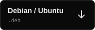
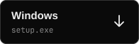

<div align="center">

<a href="https://github.com/NickiCat/yakey-desktop/releases/latest"></a>

[English](README.md) · **Русский**

</div>

**yakey** генерирует одноразовые коды Яндекс Ключа на компьютере. Приложение один раз импортирует аккаунты из облачной резервной копии, хранит их в зашифрованном виде и показывает коды TOTP и Yandex OTP. Оно бесплатное, с открытым кодом и без телеметрии.

> Неофициальный проект, не связан с Яндексом и не одобрен им.

## Скачать

<a href="https://github.com/NickiCat/yakey-desktop/releases/download/v0.4.0/yakey-0.4.0-1-x86_64.pkg.tar.zst"></a>
<a href="https://github.com/NickiCat/yakey-desktop/releases/download/v0.4.0/yakey_0.4.0_amd64.deb"></a>
<a href="https://github.com/NickiCat/yakey-desktop/releases/download/v0.4.0/yakey-0.4.0.x86_64.rpm"></a>
<a href="https://github.com/NickiCat/yakey-desktop/releases/download/v0.4.0/yakey-0.4.0-setup.exe"></a>

Версия 0.4.0, x86-64 · [все релизы](https://github.com/NickiCat/yakey-desktop/releases) · [контрольные суммы SHA-256](https://github.com/NickiCat/yakey-desktop/releases/download/v0.4.0/SHA256SUMS)

<details>
<summary><b>Установка</b></summary>
<br>

```sh
# Arch
sudo pacman -U ./yakey-0.4.0-1-x86_64.pkg.tar.zst

# Debian, Ubuntu
sudo apt install ./yakey_0.4.0_amd64.deb

# Fedora
sudo dnf install ./yakey-0.4.0.x86_64.rpm
```

На Windows запустите `yakey-0.4.0-setup.exe`. У установщика нет цифровой подписи, поэтому SmartScreen покажет предупреждение: **Подробнее** → **Выполнить в любом случае**.

</details>

## Что умеет

Откройте любую строку.

<details>
<summary><b>Импорт из облака</b></summary>
<br>

Номер телефона, код из СМС, пароль бэкапа — и аккаунты на месте. При повторном импорте уже добавленные секреты пропускаются. Протокол повторяет [YandexKeyExtractor](https://github.com/ezhevita/YandexKeyExtractor).

</details>

<details>
<summary><b>Коды</b></summary>
<br>

TOTP с SHA1, SHA256 или SHA512 и длиной от 6 до 8 цифр, а также Yandex OTP: 8 букв, с PIN-кодом. В бэкапе PIN не хранится, поэтому его вводят при импорте или позже в карточке аккаунта.

</details>

<details>
<summary><b>Добавление вручную</b></summary>
<br>

Ссылка `otpauth://`, base32-секрет или QR-код из файла. На Linux с wlroots ещё и с области экрана, через `grim` и `slurp`.

</details>

<details>
<summary><b>Защита хранилища</b></summary>
<br>

Argon2id и XChaCha20-Poly1305, атомарная запись. Хранилище блокируется вместе с экраном, при уходе в сон и по умолчанию через 5 минут бездействия. Мастер-пароль может быть сложным, обычным, коротким PIN-кодом или отключённым: тогда ключ хранилища держит системная связка ключей.

</details>

<details>
<summary><b>Очистка буфера</b></summary>
<br>

Скопированный код удаляется из буфера через 30 секунд, если он всё ещё там. На Wayland копирование идёт через `wl-copy --sensitive`, поэтому менеджеры истории вроде cliphist его не сохраняют.

</details>

<details>
<summary><b>Значок в трее</b></summary>
<br>

Значок серый, когда хранилище заблокировано. Из его меню можно открыть приложение и быстрый выбор, скопировать код любого аккаунта и заблокировать хранилище.

</details>

<details>
<summary><b>Работа по горячей клавише (Linux)</b></summary>
<br>

```sh
yakey --hidden         # запустить в фоне
yakey --pick           # окно поиска, Enter копирует код
yakey --pick --paste   # то же, но код вводится через wtype
yakey --lock           # заблокировать хранилище
yakey --lock --full    # заблокировать и стереть ключ из памяти
yakey --copy github    # скопировать код по имени
```

Примеры для Hyprland лежат в [contrib](contrib). Необязательные пакеты: `wl-clipboard`, `wtype`, `grim`, `slurp`, `fprintd`.

</details>

<details>
<summary><b>Разблокировка отпечатком (Linux)</b></summary>
<br>

С `fprintd` после однократного ввода пароля хранилище открывается пальцем, по умолчанию в течение 8 часов. После перезапуска, по истечении этого срока или после `yakey --lock --full` снова понадобится пароль.

</details>

## Linux или Windows

| | Linux | Windows |
|---|---|---|
| Импорт, коды, трей, окно выбора | Да | Да |
| Блокировка с экраном и при уходе в сон | Да | Да |
| Режим без пароля | gnome-keyring или KWallet | DPAPI |
| QR-код из файла | Да | Да |
| QR-код с области экрана | `grim`, `slurp` | Нет |
| Ввод кода в активное окно | `wtype` | Нет |
| Отпечаток пальца | `fprintd` | Нет |

Хранилище лежит в `~/.local/share/yakey/vault.bin` на Linux и в `%APPDATA%\yakey\vault.bin` на Windows.

## Безопасность

- В сеть приложение выходит только при импорте бэкапа.
- Секреты и PIN-коды остаются в главном процессе и не попадают в интерфейс. Коды считаются там же.
- Секреты не передаются через аргументы командной строки, а в отладочном журнале скрыты номер телефона, код из СМС и содержимое бэкапа.
- Буферы с ключами обнуляются после использования. Строки JavaScript обнулить нельзя, поэтому при блокировке ссылки на них сбрасываются и остаются на сборщик мусора.

## Сборка из исходников

Нужен Docker с плагином compose. Пакеты появятся в `dist/`.

```sh
./build-docker.sh                  # все четыре
./build-docker.sh deb arch fedora win
```

Для разработки: `npm install`, затем `npm run dev`, `npm test` или `npm run typecheck`.

## Лицензия

[MIT](LICENSE)
